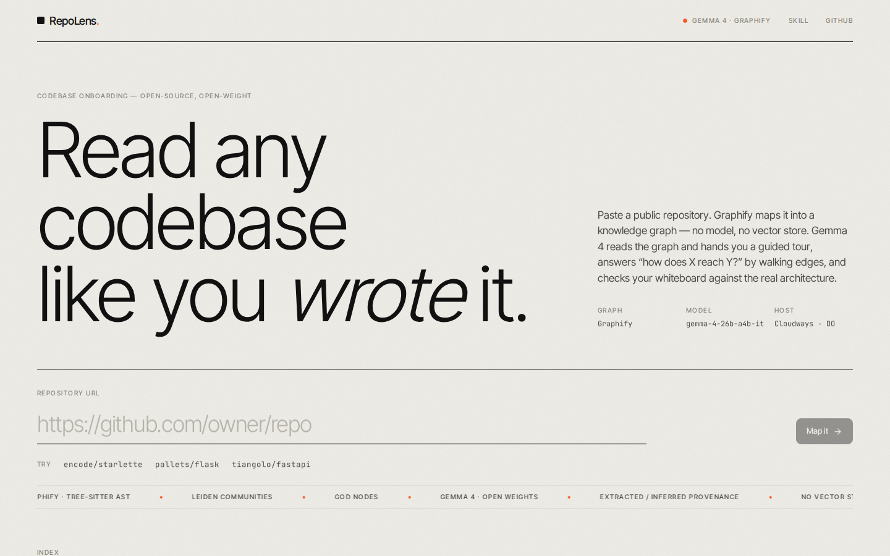
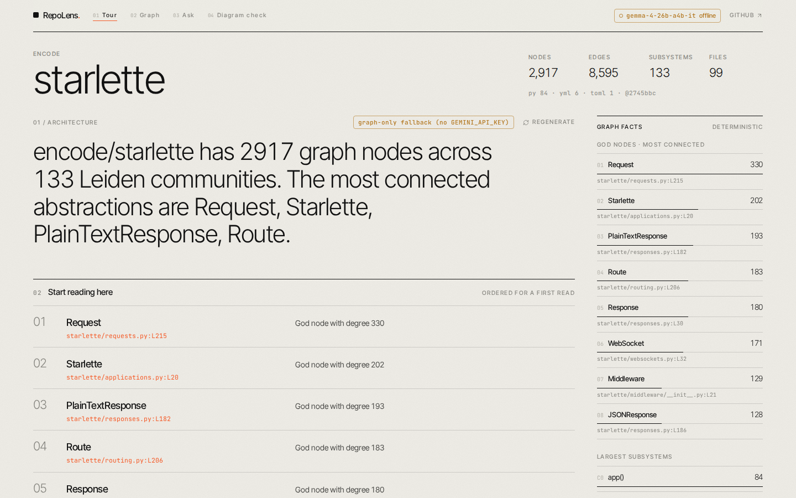
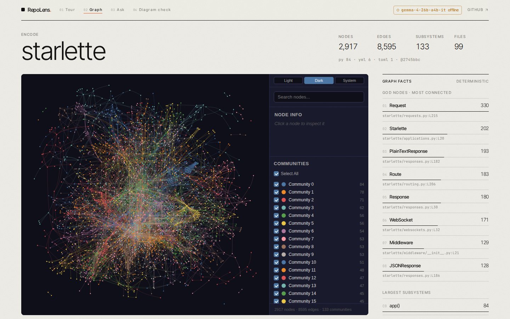

# RepoLens

**Read any codebase like you wrote it.** Visual codebase onboarding powered by a knowledge graph and an open-weight model.

Paste a public GitHub URL. [Graphify](https://github.com/Graphify-Labs/graphify) parses the code into a
knowledge graph (tree-sitter AST, Leiden communities, "god nodes"; no LLM, no vector store). Then
**Gemma 4** (`gemma-4-26b-a4b-it`, open weights, served via the Gemini API) turns that graph into a guided
tour, answers *"how does auth reach the database?"* by traversing edges instead of grepping, and reconciles
your whiteboard photo against the real architecture.

- **Live demo:** http://139.59.32.209 (pre-mapped: `encode/starlette`, `pallets/flask`, `tiangolo/fastapi` with 12.7k nodes)
- **API health:** http://139.59.32.209/api/health
- **Agent skill:** [`/repolens`](skills/repolens/SKILL.md) for Cursor, Claude Code, Codex and any [Agent Skills](https://agentskills.io/specification)-compatible agent
- **Hackathon:** Hacktoberfest 2026 Hack Day Hyderabad (MLH), entered in *Best Use of Gemma 4*, *Best Open-Source AI Project*, *Best Use of Graphify*, *Best Use of Cloudways*







---

## Table of contents

1. [What it does](#what-it-does)
2. [Architecture](#architecture)
3. [Model and key dependencies](#model-and-key-dependencies)
4. [Run locally](#run-locally)
5. [Configuration](#configuration)
6. [API](#api)
7. [Deploy](#deploy)
8. [Use it as an agent skill](#use-it-as-an-agent-skill)
9. [Design](#design)
10. [Known limits](#known-limits)
11. [Repository layout](#repository-layout)
12. [Security notes](#security-notes)
13. [License](#license)

## What it does

| Tab | What you get | Who does the work |
| --- | --- | --- |
| **Tour** | Architecture summary, "start reading here" symbols with `file:line`, Leiden subsystems *named by Gemma 4*, reading path, gotchas, downloadable `ONBOARDING.md` | Graphify evidence → Gemma 4 |
| **Graph** | Graphify's interactive `graph.html` (click nodes, filter communities, search) with Gemma's subsystem names applied | Graphify |
| **Ask** | "How does X reach Y?" — question terms are resolved to graph nodes, a 2-hop neighbourhood and shortest paths are extracted, and Gemma 4 answers *only* from that evidence with citations. Every edge shown is tagged `EXTRACTED` (explicit in source) or `INFERRED` (resolved by Graphify) | Graphify traversal → Gemma 4 |
| **Diagram check** | Upload a whiteboard photo or architecture diagram. Gemma 4 (vision) reads boxes and arrows and compares them with the real graph: found / missing / stale, plus a drift score. Each match is then verified deterministically against graph nodes | Gemma 4 vision + graph verification |

Try the diagram check with [`demo/starlette-whiteboard.png`](demo/starlette-whiteboard.png): it deliberately
contains a "GraphQL layer" (removed from Starlette years ago) and a "Redis cache" (never existed), which the
check flags as not in the code.

## Architecture

```mermaid
flowchart LR
  Browser --> Web["Next.js 16<br/>(Cloudways Velocity, or the Droplet behind nginx)"]
  Web -->|"/api/* rewrite (server-side)"| API["FastAPI (DigitalOcean Droplet)"]
  API --> Clone["git clone --depth 1"]
  Clone --> GF["graphify extract --code-only<br/>graphify cluster-only --no-label"]
  GF --> Out["graph.json · GRAPH_REPORT.md · graph.html<br/>.graphify_analysis.json"]
  Out --> Tools["graph_tools.py (networkx)<br/>god nodes · communities · seeds · 2-hop BFS · shortest paths"]
  Tools -->|"cited evidence only"| Gemma["Gemma 4 (gemma-4-26b-a4b-it)<br/>text + vision via Gemini API"]
  Gemma --> API
  Gemma -->|"subsystem names"| Labels[".graphify_labels.json → graph.html re-export"]
```



**The AI's role.** Graphify is the deterministic data layer: it decides *what is true* about the code.
Gemma 4 is the reasoning layer: it names subsystems, writes the tour, narrates paths and reads diagrams,
but it is only ever shown graph evidence with `file:line` citations and is instructed to answer from it.
Gemma's subsystem names are written back to `graphify-out/.graphify_labels.json` and `graph.html` is
re-exported, so Graphify's own HTML view and CLI show human names instead of "Community N".

**Pipeline per repository** (all deterministic):

1. `git clone --depth 1 --single-branch` into `backend/data/<owner>__<repo>/repo`
2. `graphify extract repo --code-only` → `graphify-out/graph.json` (+ AST cache, manifest)
3. `graphify cluster-only repo --no-label` → `GRAPH_REPORT.md`, `graph.html`, `.graphify_analysis.json` (god nodes, cohesion, surprising edges, suggested questions)
4. Job state is persisted to `job.json`, so mapped repos survive restarts and open instantly.

**How "Ask" stays grounded:** words in the question are matched against node labels and file basenames
(production code ranked above `tests/`, `benchmarks/`, `examples/`; `# NOTE`/`# WHY` rationale nodes are
evidence, never seeds). From those seeds a 2-hop BFS is trimmed to the ~45 most connected nodes and ~70
edges, shortest paths between seed pairs are added, `graphify query` output is appended as extra context,
and the whole package is handed to Gemma 4 with the rule "answer only from evidence, cite `file:line`".
The UI shows the exact seeds, paths and edges that were used.

## Model and key dependencies

| Component | Role | License / terms |
| --- | --- | --- |
| **Gemma 4** `gemma-4-26b-a4b-it` — open-weight 26B mixture-of-experts, text + image input, served through the Gemini API (`gemma-4-31b-it` also works) | tour, subsystem naming, chat, diagram vision | [Gemma Terms of Use](https://ai.google.dev/gemma/terms) · [model overview](https://ai.google.dev/gemma/docs/core) |
| **Graphify** (`graphifyy` on PyPI, CLI `graphify`) | AST → knowledge graph, Leiden clustering, god nodes, `query` / `path` / `explain`, `graph.html` export | [Apache-2.0](https://github.com/Graphify-Labs/graphify) |
| FastAPI, uvicorn, networkx, python-multipart, google-genai | backend | MIT / BSD-3 / Apache-2.0 |
| Next.js 16, React 19, Tailwind CSS 4, react-markdown, lucide-react | frontend | MIT / ISC |
| nginx, systemd | hosting | BSD-2 / LGPL |

Gemma 4 is the only model in the stack; there is no proprietary model. It can also be run locally
(Ollama / Transformers): swap `backend/app/gemma.py::_generate`, which is one function.

## Run locally

Prerequisites: Python 3.10+, Node 22, [uv](https://docs.astral.sh/uv/), git, and a
[Google AI Studio](https://aistudio.google.com/apikey) key (Gemma 4 is served by the Gemini API).

```bash
git clone https://github.com/tf153/RepoLens.git && cd RepoLens

# 1. graph layer
uv tool install "graphifyy[leiden]"          # installs the `graphify` CLI

# 2. backend  (http://localhost:8000)
cd backend
uv venv .venv && uv pip install -r requirements.txt --python .venv/bin/python
cp .env.example .env && $EDITOR .env         # set GEMINI_API_KEY (optional: without it, graph-only fallback mode)
set -a && . ./.env && set +a
.venv/bin/uvicorn app.main:app --reload --port 8000

# 3. frontend (http://localhost:3000), in another shell
cd frontend
npm install
BACKEND_URL=http://127.0.0.1:8000 npm run dev
```

Open http://localhost:3000 and paste e.g. `https://github.com/encode/starlette` (about 20 s to map).

## Configuration

No secrets are stored in this repository. `*.env` is gitignored; templates live in
[`backend/.env.example`](backend/.env.example) and [`frontend/.env.example`](frontend/.env.example).
On a server the backend reads `/etc/repolens.env` (see [`deploy/repolens.service`](deploy/repolens.service)).

### Backend

| Variable | Default | Purpose |
| --- | --- | --- |
| `GEMINI_API_KEY` | – | Required for Gemma 4 (tour, chat, diagram). Without it the app runs in graph-only fallback mode and says so in the UI. |
| `GEMMA_MODEL` | `gemma-4-26b-a4b-it` | Alternative: `gemma-4-31b-it` |
| `REPOLENS_DATA_DIR` | `backend/data` | Clones, graphs, cached tours |
| `REPOLENS_MAX_FILES` | `6000` | Refuse larger repositories (hosted-demo guard) |
| `REPOLENS_CLONE_TIMEOUT` / `REPOLENS_EXTRACT_TIMEOUT` / `REPOLENS_QUERY_TIMEOUT` | `180` / `900` / `60` | Seconds |
| `GRAPHIFY_BIN` | `graphify` on `PATH` | Path to the Graphify CLI |

Graphify itself is run with `GRAPHIFY_BACKEND=none` and `--code-only`, so it never calls a model and the
source code never leaves the machine.

### Frontend

| Variable | Default | Purpose |
| --- | --- | --- |
| `BACKEND_URL` | `http://127.0.0.1:8000` | Origin that `/api/*` is rewritten to, server-side. Set to `http://<droplet-ip>/api` when the backend sits behind the nginx config in `deploy/`. |

## API

```
GET  /health                        -> {ok, gemma, model}
POST /analyze {repo_url}            -> {job_id, status, name, cached?}   (?force=true re-maps)
GET  /jobs/{id}                     -> status: queued|cloning|extracting|reporting|ready|error, message, stats
GET  /repos                         -> ready repos with stats and has_tour
GET  /repos/{id}/summary            -> stats, god nodes, communities, top dirs, surprises, suggested questions
GET  /repos/{id}/graph.html         -> Graphify interactive graph (iframe-able)
GET  /repos/{id}/report             -> GRAPH_REPORT.md
POST /repos/{id}/tour               -> Gemma 4 tour, cached to tour.json   (?refresh=true regenerates)
POST /repos/{id}/chat {question}    -> {answer, seeds, paths, evidence, explored, model}
GET  /repos/{id}/path?a=&b=         -> shortest path between two symbols, with per-hop provenance
GET  /repos/{id}/explain?symbol=    -> graphify explain output
POST /repos/{id}/diagram (multipart image) -> {components, relationships, missing_in_diagram, drift_summary, drift_score}
```

Accepted clone hosts: github.com, gitlab.com, codeberg.org, bitbucket.org (public HTTPS; `git@` URLs are
rewritten). Diagram uploads: PNG / JPEG / WebP up to 8 MB.

## Deploy

Two services: the Next.js frontend (Node) and the FastAPI + Graphify backend (Python). Graphify is a Python
CLI, so the backend needs a VM; the frontend can run on **Cloudways Velocity** (managed Node.js) or on the
same VM. Everything is served through **nginx on port 80**, so no non-standard ports are needed anywhere:
`/` → Next.js, `/api/` → FastAPI.

**Backend (and optional frontend) on a DigitalOcean Droplet** — Ubuntu 24.04, 2 GB RAM is enough:

```bash
curl -fsSL https://raw.githubusercontent.com/tf153/RepoLens/main/deploy/setup.sh | bash -s -- --with-web
nano /etc/repolens.env          # GEMINI_API_KEY=...
systemctl restart repolens
curl http://127.0.0.1/api/health
```

`setup.sh` is idempotent: it installs git, uv, `graphifyy[leiden]`, nginx and (with `--with-web`) Node 22,
creates the venv, writes `/etc/repolens.env` from a template if missing, installs the systemd units
(`repolens`, `repolens-web`) and the nginx site, and opens ports 80/443 in ufw if ufw is active.
Re-deploy with `cd /root/RepoLens && git pull && bash deploy/setup.sh --with-web`.

**Frontend on Cloudways Velocity:** connect the GitHub repo, preset *Next.js*, branch `main`, root
`frontend`, Node 22, env `BACKEND_URL=http://<droplet-ip>/api`, deploy. Step-by-step with screenshots'
worth of detail in [deploy/CLOUDWAYS.md](deploy/CLOUDWAYS.md).

## Use it as an agent skill

```bash
# Cursor (project-local)                       # Agent Skills generic location
cp -r skills/repolens .cursor/skills/   ;   cp -r skills/repolens .agents/skills/
```

Then type `/repolens` in your agent. The skill:

1. runs `graphify extract . --code-only` and `graphify cluster-only . --no-label` if `graphify-out/` is missing;
2. runs `scripts/tour.py`, which builds the same evidence pack as the web app and asks Gemma 4 to write
   `ONBOARDING.md` (falls back to a graph-only document without `GEMINI_API_KEY`), and saves Gemma's
   subsystem names to `.graphify_labels.json`;
3. answers structural questions with `graphify path "A" "B"`, `graphify explain "X"`, `graphify query "..."`
   and `graphify affected "X"`, citing `file:line` and distinguishing `EXTRACTED` from `INFERRED` edges.

It follows the [Agent Skills specification](https://agentskills.io/specification): `SKILL.md` frontmatter with
`name`, `description`, `license`, `compatibility`, `metadata`; `scripts/tour.py` is stdlib-only plus
`google-genai`.

## Design

The UI is a Swiss-editorial system: warm paper canvas, ink type with grey carrying the hierarchy, a single
ember accent, oversized light-weight display type (Inter Tight 300), hairline rules instead of cards,
uppercase micro-labels, film grain and a marquee. The dark Graphify graph sits on the page as a captioned
figure. Long-running steps are shown as numbered "action streams" (clone → parse → cluster → ready; resolve →
traverse → paths → compose) instead of spinners, and provenance is typographic: a filled dot is `EXTRACTED`,
an outlined dot is `INFERRED`.

## Known limits

- **Latency.** Gemma 4 on the Gemini API thinks before answering and counts those tokens against
  `max_output_tokens`; the API exposes no knob to turn thinking off for Gemma. A fresh tour takes roughly
  60–90 s (two Gemma calls run in parallel: structured tour + onboarding doc); chat answers take 10–30 s.
  Tours are cached per repository, so demo repos open instantly. Graph-only fallback tours are never cached,
  so they upgrade automatically once a key is configured.
- **Repository size.** The hosted demo refuses repositories above `REPOLENS_MAX_FILES` (6000). Graphs above
  ~5000 nodes render as Graphify's aggregated community view in `graph.html`.
- **Public repositories only.** Clones are unauthenticated, depth 1.
- **Symbol resolution** is label-based: very generic words (`request`, `data`) are only used as seeds when
  nothing more specific matches.

## Repository layout

```
backend/
  app/main.py             FastAPI routes
  app/graphify_runner.py  clone -> graphify extract --code-only -> cluster-only; graph.html re-export
  app/graph_tools.py      networkx over graph.json: god nodes, communities, seeds, BFS, shortest paths, evidence text
  app/gemma.py            Gemma 4 prompts: tour (2 parallel calls) / chat / diagram_check, graph-only fallbacks
  app/jobs.py             job store persisted to data/<repo>/job.json
  app/config.py           environment-driven settings
  .env.example            backend configuration template (no secrets committed)
  requirements.txt
frontend/
  app/page.tsx            home: URL input, pipeline action stream, index of mapped repos
  app/r/[id]/page.tsx     workspace: Tour · Graph · Ask · Diagram check, graph-facts column
  components/             TourPanel, AskPanel, DiagramPanel, ui primitives, Logo, Markdown
  lib/api.ts              typed client for /api/*
  next.config.ts          /api/* -> BACKEND_URL rewrite
  .env.example
skills/repolens/
  SKILL.md                Agent Skills-compliant skill
  scripts/tour.py         graph -> Gemma 4 -> ONBOARDING.md (stdlib + google-genai)
deploy/
  setup.sh                idempotent Droplet bootstrap (uv, graphify, venv, nginx, systemd, optional Node + web)
  nginx-repolens.conf     port 80: / -> :3000, /api/ -> :8000
  repolens.service        FastAPI systemd unit (reads /etc/repolens.env)
  repolens-web.service    Next.js systemd unit
  CLOUDWAYS.md            Velocity + Droplet deployment guide
demo/
  screenshot-*.png        UI screenshots used above
  starlette-whiteboard.png  test diagram with deliberate drift for the Diagram check
```

## Security notes

- No API keys or tokens are committed; `*.env` is gitignored and only `.env.example` templates are tracked.
  The server reads secrets from `/etc/repolens.env` (mode 600) via systemd `EnvironmentFile`.
- The backend binds to `127.0.0.1` only; nginx is the single public entry point on port 80.
- Clone URLs are validated against an allow-list of hosts and `owner/repo` character sets; clones run with
  `GIT_TERMINAL_PROMPT=0` and a timeout; repositories above the file limit are rejected before extraction.
- Graphify runs with `GRAPHIFY_BACKEND=none`: analysed source code is never sent to any model. Only the graph
  summary (symbol names, file paths, line numbers, edge types) and the README excerpt are sent to Gemma 4.
- Uploaded diagrams are held in memory for the duration of the request and not stored.

## License

Apache-2.0 — see [LICENSE](LICENSE). Gemma 4 weights are governed by the
[Gemma Terms of Use](https://ai.google.dev/gemma/terms). Graphify is Apache-2.0.
