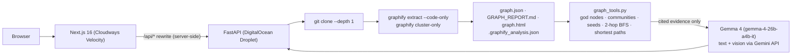

# RepoLens

**Visual codebase onboarding, powered by a knowledge graph and an open-weight model.**

Paste a public GitHub URL. [Graphify](https://github.com/Graphify-Labs/graphify) parses the code into a
knowledge graph (tree-sitter AST, Leiden communities, "god nodes"; no LLM, no vector store). Then
**Gemma 4** turns that graph into a guided tour, answers *"how does auth reach the database?"* by
traversing edges (not grepping), and reconciles your whiteboard photo against the real architecture.

Live demo: **http://139.59.32.209** · API: `http://139.59.32.209/api/health`
Cloudways Velocity URL: see [deploy/CLOUDWAYS.md](deploy/CLOUDWAYS.md) once connected.

Built for Hacktoberfest 2026 Hack Day: *Best Open-Source AI Project*, *Best Use of Gemma 4*,
*Best Use of Graphify*, *Best Use of Cloudways*.

---

## What it does

| Tab | What you get | Who does the work |
| --- | --- | --- |
| **Tour** | Architecture summary, "start reading here" symbols with `file:line`, Leiden subsystems *named by Gemma 4*, reading path, gotchas, downloadable `ONBOARDING.md` | Graphify evidence -> Gemma 4 |
| **Graph** | Graphify's interactive `graph.html` (click nodes, filter communities, search) with Gemma's subsystem names applied | Graphify |
| **Ask** | "How does X reach Y?" - seeds are resolved to graph nodes, a 2-hop neighbourhood and shortest paths are extracted, and Gemma 4 answers *only* from that evidence with citations. Every edge shown is tagged `EXTRACTED` / `INFERRED` | Graphify traversal -> Gemma 4 |
| **Diagram check** | Upload a whiteboard photo / architecture diagram. Gemma 4 (vision) reads boxes and arrows and compares them with the real graph: found / missing / stale, drift score | Gemma 4 vision + graph verification |

Plus an **Agent Skill** (`/repolens`, [skills/repolens/SKILL.md](skills/repolens/SKILL.md)) that does the same
inside Cursor, Claude Code, Codex or any [Agent Skills](https://agentskills.io/specification)-compatible agent.

## Architecture



**The AI's role.** Graphify is the deterministic data layer: it decides *what is true* about the code.
Gemma 4 is the reasoning layer: it names subsystems, writes the tour, narrates paths and reads diagrams,
but it is only ever shown graph evidence with `file:line` citations and is instructed to answer from it.
Gemma's subsystem names are written back to `graphify-out/.graphify_labels.json`, so the Graphify HTML
view and CLI also benefit.

## Model and key dependencies

| Component | What | License / terms |
| --- | --- | --- |
| **Gemma 4** `gemma-4-26b-a4b-it` (open-weight, 26B MoE, text + image input) served through the Gemini API; `gemma-4-31b-it` also works | tour, chat, diagram vision | [Gemma Terms of Use](https://ai.google.dev/gemma/terms) · [model overview](https://ai.google.dev/gemma/docs/core) |
| **Graphify** (`graphifyy` on PyPI) | AST -> knowledge graph, Leiden, god nodes, `query/path/explain`, `graph.html` | [Apache-2.0](https://github.com/Graphify-Labs/graphify) |
| FastAPI, uvicorn, networkx, google-genai | backend | MIT / BSD / Apache-2.0 |
| Next.js 16, React 19, Tailwind 4, react-markdown | frontend | MIT |

Gemma 4 can also be run locally (Ollama / Transformers); point `google-genai` at your own
OpenAI-compatible endpoint or swap `backend/app/gemma.py::_generate` - it is one function.

## Run locally

Prereqs: Python 3.10+, Node 22, [uv](https://docs.astral.sh/uv/), a
[Google AI Studio](https://aistudio.google.com/) key (`GEMINI_API_KEY`).

```bash
git clone https://github.com/tf153/RepoLens.git && cd RepoLens

# graph layer
uv tool install "graphifyy[leiden]"

# backend  (http://localhost:8000)
cd backend && uv venv .venv && uv pip install -r requirements.txt --python .venv/bin/python
export GEMINI_API_KEY=...            # optional: without it the app runs in graph-only fallback mode
.venv/bin/uvicorn app.main:app --reload --port 8000

# frontend (http://localhost:3000), in another shell
cd frontend && npm install && BACKEND_URL=http://127.0.0.1:8000 npm run dev
```

Open http://localhost:3000, paste e.g. `https://github.com/encode/starlette`.

### API

```
POST /analyze {repo_url}            -> {job_id}
GET  /jobs/{id}                     -> status: queued|cloning|extracting|reporting|ready|error
GET  /repos                         -> ready repos
GET  /repos/{id}/summary            -> stats, god nodes, communities, surprises
GET  /repos/{id}/graph.html         -> Graphify interactive graph
GET  /repos/{id}/report             -> GRAPH_REPORT.md
POST /repos/{id}/tour[?refresh=1]   -> Gemma 4 tour (cached)
POST /repos/{id}/chat {question}    -> answer + seeds + paths + evidence edges
GET  /repos/{id}/path?a=&b=         -> shortest path between two symbols
GET  /repos/{id}/explain?symbol=    -> graphify explain
POST /repos/{id}/diagram (image)    -> components / missing / drift_summary / drift_score
```

## Deploy

Frontend on **Cloudways Velocity** (managed Node.js), backend on a **DigitalOcean Droplet**
(Graphify is a Python CLI). One script bootstraps the Droplet:

```bash
curl -fsSL https://raw.githubusercontent.com/tf153/RepoLens/main/deploy/setup.sh | bash
```

Full steps, Velocity settings and environment reference: [deploy/CLOUDWAYS.md](deploy/CLOUDWAYS.md).

## Use it as an agent skill

```bash
# Cursor (project-local)            # Agent Skills generic location
cp -r skills/repolens .cursor/skills/ ;  cp -r skills/repolens .agents/skills/
```

Then in your agent: `/repolens` - it runs `graphify extract` if needed, writes `ONBOARDING.md` with Gemma 4,
and answers structural questions with `graphify path/explain/query`. The skill follows the
[Agent Skills specification](https://agentskills.io/specification) (`SKILL.md` frontmatter: `name`, `description`,
`license`, `compatibility`, `metadata`).

## Repository layout

```
backend/app/
  main.py             FastAPI routes
  graphify_runner.py  clone -> graphify extract --code-only -> cluster-only
  graph_tools.py      networkx over graph.json: god nodes, communities, seeds, BFS, shortest paths, evidence text
  gemma.py            Gemma 4 prompts: tour / chat / diagram_check (+ graph-only fallbacks)
  jobs.py             job store persisted to data/<repo>/job.json
frontend/             Next.js app (Tour · Graph · Ask · Diagram check)
skills/repolens/      Agent Skill (SKILL.md + scripts/tour.py)
deploy/               setup.sh, systemd units, CLOUDWAYS.md
```

## License

Apache-2.0 - see [LICENSE](LICENSE). Gemma 4 weights are governed by the
[Gemma Terms of Use](https://ai.google.dev/gemma/terms).
